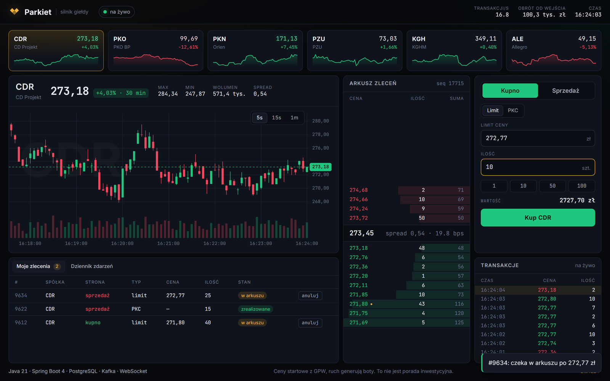

# Parkiet — silnik giełdy

[](https://github.com/Sitkowski01/parkiet-exchange/actions/workflows/ci.yml)

Silnik giełdy w **Javie 21** i **Spring Boot 4**: przyjmuje zlecenia kupna i sprzedaży,
kojarzy je w arkuszu według **ceny, a potem czasu** — tak jak GPW — i publikuje transakcje.

Cena na giełdzie nie przychodzi z zewnątrz. To cena ostatniej transakcji, czyli moment,
w którym czyjeś kupno spotkało się z czyjąś sprzedażą. Ten projekt jest źródłem notowań,
nie ich odbiorcą.



```bash
./gradlew bootRun --args='--spring.profiles.active=demo'   # Docker; potem http://localhost:8080
```

## Stan

| Etap | Zakres | |
|---|---|---|
| 1 | Szkielet, CI, narzędzia testowe | ✅ |
| 2 | Arkusz zleceń: LIMIT, MARKET, anulowanie, głębokość rynku | ✅ |
| 3 | Silnik: jeden wątek na instrument, kolejka poleceń | ✅ |
| 4 | REST API, dziennik zdarzeń w PostgreSQL (Flyway, Testcontainers) | ✅ |
| 5 | Zapis poza wątkiem silnika, transactional outbox → Kafka | ✅ |
| 6 | Notowania na żywo przez WebSocket | ✅ |
| 7 | Boty rynkowe zakotwiczone w cenach GPW | ✅ |
| 8 | Restart z dziennika (event sourcing), wykres ze świec, metryki, benchmarki, terminal w przeglądarce | ✅ |

## Arkusz zleceń

```
        KUPNO (bids)                 SPRZEDAŻ (asks)
   cena   ilość  zleceń          cena   ilość  zleceń
  100.00     50      2   ◄─┐  ┌─► 100.50     30      1
   99.50    120      4     │  │   101.00     80      3
   99.00     10      1     │  │   102.00    200      5
                     najlepsze ceny
                (spread = 100.50 − 100.00)
```

- **Priorytet ceny, potem czasu.** Najpierw wygrywa najwyższa oferta kupna i najniższa
  sprzedaży. Przy tej samej cenie — zlecenie, które przyszło wcześniej.
- **Transakcja po cenie zlecenia czekającego.** Kupujący gotów zapłacić 105 zł trafia na
  sprzedaż po 100 zł i płaci 100 zł.
- **LIMIT** — to, czego nie da się skojarzyć od razu, czeka w arkuszu.
  **MARKET** — bierze, co jest, a resztę anuluje; nigdy nie czeka.
- **Ceny w groszach jako `long`**, nigdy `double`. Zamiana na złotówki dopiero na brzegu systemu.

Kod: [`domain/OrderBook.java`](src/main/java/io/github/sitkowski01/exchange/domain/OrderBook.java).
Domena to czysta Java bez Springa — pilnuje tego test ArchUnit.

## Silnik

```
 wątki HTTP ──┐
 wątki HTTP ──┼──► [ kolejka CDR ] ──► wątek engine-CDR ──► arkusz CDR ──► EventSink
 boty ────────┘     (ograniczona)       (jedyny, który        │
                                         go dotyka)           └──► odpowiedź (CompletableFuture)
              ───► [ kolejka PKO ] ──► wątek engine-PKO ──► arkusz PKO
```

- **Jeden wątek na instrument.** Arkusz dotyka tylko on, więc kojarzenie nie potrzebuje
  żadnych blokad, a kolejność jest jednoznaczna. Ten sam model stoi za LMAX Disruptor.
- **Id zleceń nadaje wątek silnika**, nie wołający — inaczej dwa równoległe żądania
  mogłyby wejść do kolejki w innej kolejności niż numeracja.
- **Ograniczona kolejka = backpressure.** Pełna kolejka odrzuca polecenie od razu,
  zamiast rosnąć w pamięci, aż serwer padnie.
- **Zdarzenia mają numer kolejny bez dziur** — odbiorca od razu widzi, że coś zgubił.
- **Zamykanie** kończy wszystkie przyjęte polecenia; jest odporne na przerwania wątku
  i odmawia wywołania z wątku silnika, które czekałoby na samo siebie.

## REST API

```bash
./gradlew bootRun     # potrzebny Docker: sam podnosi Postgresa i Kafkę z compose.yaml

curl localhost:8080/api/instruments
# ["CDR","PKO","PKN","PZU","KGH","ALE"]

curl -X POST localhost:8080/api/instruments/CDR/orders -H 'Content-Type: application/json' \
     -d '{"side":"SELL","type":"LIMIT","price":"250.40","quantity":10}'
# {"orderId":1,"events":[{"type":"RESTED","orderId":1,"side":"SELL","price":"250.40","quantity":10}]}

curl -X POST localhost:8080/api/instruments/CDR/orders -H 'Content-Type: application/json' \
     -d '{"side":"BUY","type":"MARKET","quantity":4}'
# {"orderId":2,"events":[{"type":"TRADE","makerOrderId":1,"takerOrderId":2,"takerSide":"BUY","price":"250.40","quantity":4}]}

curl localhost:8080/api/instruments/CDR/book?levels=5
curl -X DELETE localhost:8080/api/instruments/CDR/orders/1
```

| Kod | Kiedy |
|---|---|
| 201 / 200 | zlecenie przyjęte / anulowane / arkusz |
| 400 | zła treść: ułamek grosza, LIMIT bez ceny, MARKET z ceną, ilość 10.9, nieznany enum |
| 404 | nieznana spółka albo zlecenia nie ma w arkuszu |
| 503 | kolejka spółki pełna — zlecenie **na pewno nie weszło**, można ponowić |
| 504 | silnik nie odpowiedział na czas — stan **nieznany**, nie ponawiać w ciemno |

Błędy w formacie RFC 9457 (`application/problem+json`). Ceny w JSON-ie to tekst
(`"250.40"`), żeby klient w JS nie zgubił groszy w `double`. Spółki, pojemność kolejki
i limit czasu: [`application.yml`](src/main/resources/application.yml).

## Dziennik zdarzeń w PostgreSQL

Każde zdarzenie silnika trafia do tabeli `engine_event` — w kolejności, w jakiej powstało:

```
 run_id | symbol | sequence |  type     | side | price | quantity | reason
--------+--------+----------+-----------+------+-------+----------+-----------
      1 | PKO    |        1 | RESTED    | SELL |  6410 |      100 |
      1 | PKO    |        2 | TRADE     | BUY  |  6410 |       30 |
      1 | PKO    |        3 | CANCELLED |      |       |       70 | REQUESTED
```

- **Paczka zdarzeń jednego zlecenia w jednej transakcji** — nigdy pół zlecenia w bazie.
- **`run_id`** — przebieg giełdy. Restart go kontynuuje (patrz niżej); nowy przebieg z numeracją od 1 zaczyna się tylko przy `exchange.journal.resume=false`.
- **Schemat pilnuje kształtu wiersza** (`CHECK`): transakcja musi mieć makera i takera,
  anulowanie nie ma ceny. Migracje: Flyway ([`db/migration`](src/main/resources/db/migration)).
- **Zapis poza wątkiem silnika.** Silnik wrzuca zdarzenia do kolejki i wraca do kojarzenia;
  wątek `event-writer` zapisuje wszystko, co się nazbierało, jedną transakcją (group commit).
- **Baza leży → giełda staje, ale nic nie ginie.** Zapis jest ponawiany do skutku; gdy kolejka
  się zapełni, silnik czeka (backpressure). Insert jest idempotentny, więc ponowienie nie dubluje.

## Zdarzenia w Kafce (transactional outbox)

```
engine_event ──► OutboxRelay (co 100 ms) ──► Kafka: exchange.events, klucz = spółka
 (id > kursor)    1 transakcja: zablokuj kursor → wyślij → poczekaj na ack → przesuń kursor
```

Dziennik w bazie jest jedynym źródłem prawdy; do Kafki trafia z niego, nigdy z pominięciem.
Dzięki temu Kafka nie zobaczy zdarzenia, którego nie ma w bazie, a padnięty broker niczego nie gubi —
kursor stoi, dopóki broker nie potwierdzi.

- **Co najmniej raz.** Po awarii w połowie paczki część wiadomości pójdzie drugi raz.
  Odbiorca odrzuca powtórki po `(runId, symbol, sequence)`.
- **Kolejność w obrębie spółki.** Klucz = spółka → jedna partycja; producent idempotentny
  (`acks=all`), więc ponowienia nie zamieniają kolejności.
- **Dziennik zostaje append-only.** Relay pamięta tylko numer ostatniego wysłanego zdarzenia
  (`outbox_cursor`), zamiast oznaczać każdy wiersz.

Kontrakt wiadomości (JSON, ceny w groszach):

```json
{"runId":3,"symbol":"KGH","sequence":2,"timestamp":"2026-10-09T14:03:11.512Z","type":"TRADE",
 "makerOrderId":1,"takerOrderId":2,"takerSide":"BUY","price":18055,"quantity":5}
```

| `type` | pola |
|---|---|
| `RESTED` | `orderId`, `side`, `price`, `quantity` |
| `TRADE` | `makerOrderId`, `takerOrderId`, `takerSide`, `price`, `quantity` |
| `CANCELLED` | `orderId`, `quantity`, `reason` (`REQUESTED` / `NO_LIQUIDITY`) |

## Notowania na żywo (WebSocket)

```
ws://localhost:8080/ws/market?symbols=CDR,PKO
```

```json
{"type":"book","symbol":"CDR","sequence":41,"bids":[{"price":"250.30","quantity":12,"orders":2}],"asks":[...]}
{"type":"trade","symbol":"CDR","sequence":42,"timestamp":"2026-10-09T14:03:11.512Z","price":"250.40","quantity":4,"takerSide":"BUY","makerOrderId":1,"takerOrderId":2}
```

- Po podłączeniu klient dostaje **obraz arkusza** każdej spółki, potem **transakcje na bieżąco**
  i nowy obraz najwyżej co 100 ms, gdy arkusz się zmienił (conflation: przy 1000 zmian/s
  to 10 obrazów, zawsze najnowszy).
- **Zszywanie po `sequence`:** obraz uwzględnia wszystko do swojego numeru. Klient odrzuca
  transakcje o `sequence` ≤ ostatniego obrazu i obrazy starsze niż ostatni.
- **Notowania są stratne, dziennik nie.** Silnik nigdy nie czeka na notowania: gdy nie nadążają,
  paczka przepada, a spółka dostaje świeży obraz. Dziura w `sequence` transakcji = poczekaj na obraz.
- **Wolny klient nie spowalnia innych.** Każde połączenie ma własną kolejkę i wątek wirtualny;
  klient, który nie czyta, jest rozłączany (`1008 too slow`) i po ponownym połączeniu dostaje świeży obraz.

| Zamknięcie | Kiedy |
|---|---|
| `1008 unknown or missing symbols` | brak `symbols` albo nieznana spółka |
| `1008 too slow, reconnect` | kolejka klienta pełna |
| `1013 too many clients` | przekroczony limit połączeń |

## Boty i tryb demo

```bash
./gradlew bootRun --args='--spring.profiles.active=demo'
```

Giełda z ruchem: dla każdej spółki **animator rynku** trzyma kupno i sprzedaż wokół wartości
godziwej, a **gracz losowy** zbija jego kwotowania i dokłada zlecenia z limitem. Ceny startowe
to ostatnie kursy z GPW (Yahoo Finance, `CDR` → `CDR.WA`); gdy źródło nie odpowie — ceny
z konfiguracji.

```
             wartość godziwa (losowe błądzenie, kroki procentowe)
                         │
   animator: kupno ◄─────┼─────► sprzedaż      rozstęp 0,2%, przestawiane co 200 ms
                         │
   gracz losowy: 70% MARKET (transakcje), 30% LIMIT obok wartości (głębokość arkusza)
```

- Boty to zwykli klienci silnika — te same zlecenia co z HTTP, przez te same kolejki.
- Animator przestawia kwotowania **po jednej stronie naraz**, zaczynając od tej, od której cena
  ucieka: druga strona stoi cały czas, a bot nigdy nie handluje sam ze sobą.
- Każda spółka ma osobne zadanie — zablokowany silnik jednej nie zatrzymuje botów pozostałych.
- Po restarcie z dziennika boty zaczynają od środka odtworzonego arkusza, a nie od kursu z rynku —
  ich zlecenia z poprzedniego przebiegu stoją obok nowych, zamiast się z nimi krzyżować.
- Boty ruszają dopiero po pełnym starcie aplikacji i stają jako pierwsze przy zamykaniu.
- Domyślnie wyłączone: bez profilu `demo` w arkuszu jest tylko to, co złożą klienci.

## Restart bez utraty arkusza (event sourcing)

Arkusz żyje w pamięci, ale nie ma osobnej tabeli „zlecenia w arkuszu”. Stan to suma zdarzeń
z dziennika — po restarcie giełda odtwarza go, zamiast go wczytywać:

```
engine_event (ostatni run, spółka, sequence 1..n) ──► OrderBook.Rebuilder ──► arkusz + numer n
                                                                         └─► silnik numeruje dalej od n+1
```

- **Zdarzenia to fakty, nie polecenia.** Odtwarzanie nie kojarzy zleceń jeszcze raz, tylko nakłada
  skutki: `RESTED` dokłada zlecenie na koniec kolejki ceny (priorytet czasu zostaje), `TRADE`
  zmniejsza zlecenie czekające, `CANCELLED` je zdejmuje.
- **Ciągłość po restarcie.** Ten sam `run_id`, kolejne `sequence` i id zleceń — klient może anulować
  zlecenie złożone przed restartem, a odbiorca Kafki nie widzi żadnej zmiany.
- **Niespójny dziennik = giełda nie wstaje.** Dziura w numeracji albo transakcja na nieznanym
  zleceniu zatrzymuje start. Lepiej nie handlować niż handlować na złym arkuszu.
- **Strumieniowo.** Kursor po stronie bazy, zdarzenie po zdarzeniu — 200 tys. zdarzeń odtwarza się
  w ok. 2 s i nie musi mieścić się w pamięci naraz.
- **Uczciwie o granicy:** zapis jest asynchroniczny, więc po twardej awarii (kill -9) mogą przepaść
  ostatnie milisekundy pracy, które klient zdążył zobaczyć jako przyjęte. Arkusz odtwarza się wtedy
  spójnie do ostatniego zapisanego zdarzenia. Zwykłe zamknięcie zapisuje wszystko.
  Numery zleceń, które przepadły w takiej awarii, dostaną po restarcie nowe zlecenia — klient trzymający
  stary numer anulowałby cudze. Na produkcji: pula numerów rezerwowana w bazie z wyprzedzeniem.
- **Bez migawek.** Każdy start odtwarza cały przebieg od pierwszego zdarzenia, więc czas startu rośnie
  z długością pracy (boty w trybie demo dokładają zdarzenia bez przerwy). Następny krok: okresowa migawka arkusza
  i odtwarzanie od niej.

Test różnicowy sprawdza, że arkusz odbudowany z 5000 losowych zdarzeń jest nieodróżnialny od oryginału —
także w kolejnych 2000 zleceniach, czyli w priorytecie czasu, którego nie widać w samej głębokości.

## Terminal w przeglądarce

`http://localhost:8080` — strona serwowana przez samą aplikację (czysty JS, bez frameworka i bez kroku budowania):

- kafelki spółek z ceną, zmianą i wykresem z ostatnich 30 minut,
- wykres świecowy rysowany na canvasie (5 s / 15 s / 1 min), z wolumenem i krzyżem OHLC,
- arkusz z głębokością skumulowaną; klik w poziom wpisuje cenę do formularza,
- formularz zlecenia (limit / PKC) i „moje zlecenia” z anulowaniem — kropka w arkuszu pokazuje własne zlecenia,
- taśma transakcji i dziennik zdarzeń z numerami `sequence`.

Ceny w przeglądarce też są liczone w groszach na liczbach całkowitych, a komunikaty błędów pochodzą
prosto z `ProblemDetail` serwera.

**Historia do wykresu idzie z dziennika, nie z silnika** (`GET /api/instruments/CDR/candles?seconds=5&count=120`).
Świece liczy jedno zapytanie SQL (`date_bin` + `array_agg ... order by id`), więc wykres nie zabiera czasu
wątkowi, który kojarzy zlecenia, a po restarcie historia jest ta sama. To mały CQRS: zapis przez silnik,
odczyt historii prosto z bazy.

## Metryki (Prometheus + Grafana)

```bash
docker compose --profile monitoring up -d    # Grafana: http://localhost:3000, dashboard „Parkiet”
```

Każda metryka odpowiada na pytanie „gdzie się korkuje”:

```
HTTP ──► [kolejka silnika] ──► silnik ──► [kolejka zapisu] ──► Postgres ──► [lag outboxa] ──► Kafka
         exchange_engine_queue_depth      exchange_journal_pending           exchange_outbox_lag
```

Plus transakcje/s, obrót i ostatnia cena na spółkę, p50/p99 czasu odpowiedzi API, klienci WebSocket
i zgubione paczki notowań. Klasy silnika nie znają Micrometera (pilnuje tego ArchUnit) — wystawiają
zwykłe gettery, mierniki podpina `MetricsConfig`.

## Wydajność

**Rdzeń (JMH, `./gradlew jmh`)** — sam arkusz i silnik, bez sieci i bazy:

| Pomiar | Wynik |
|---|---|
| sam arkusz: zlecenie + anulowanie (mieszanka LIMIT/MARKET) | 3,3 mln zleceń/s |
| silnik, 1 spółka, klient wysyła paczki po 100 zleceń | 0,86 mln zleceń/s |
| silnik, 6 spółek z 6 wątków — spółki skalują się niezależnie | 2,5 mln zleceń/s |
| silnik, 4 klientów czekających na każdą odpowiedź | 110 tys. zleceń/s |
| czas „tam i z powrotem” jednego zlecenia | 44 µs |

Laptop z Windows, `-f 2 -wi 3 -i 5`; surowe wyniki: `build/reports/jmh/results.json`. Różnica między
paczkami a czekaniem na każdą odpowiedź to koszt budzenia wątku, nie kojarzenia.


**Cała droga HTTP → silnik → Postgres → Kafka (k6, `scripts/k6/orders.js`)** — laptop, Postgres, Kafka
i k6 w Docker Desktop na tej samej maszynie, boty handlują w tle:

| Tempo | p50 | p95 | Kolejka zapisu (max) |
|---|---|---|---|
| 1000 zleceń/s (+ anulowania) | 2,5 ms | 8 ms | 18 paczek |
| 2000 zleceń/s | 21 ms | 240 ms | 10 000 (pełna) |

Silnik kojarzy miliony zleceń na sekundę, a całość utrzymuje ok. 1–1,5 tys./s — **ograniczeniem jest
zapis do Postgresa w Dockerze**, nie kojarzenie. Widać to w metrykach: przy 2000/s kolejka zapisu
dobija do limitu i backpressure spowalnia silnik, zamiast gubić zdarzenia. Pierwszy przebieg pokazał
też tańszy problem: sterownik wysyłał paczkę insertów jako osobne polecenia — `reWriteBatchedInserts`
skleja je w jeden wielowierszowy `INSERT`. Serwer nie zwrócił przy tym ani jednego błędu.

## Testy

| Rodzaj | Co sprawdza |
|---|---|
| Jednostkowe | każda reguła kojarzenia osobno: cena, czas, częściowe realizacje, anulowanie |
| **Różnicowe** | 30 000 losowych zleceń; arkusz musi dać **identyczne zdarzenia** jak celowo naiwna implementacja-wyrocznia |
| Niezmienniki | po każdym kroku: arkusz się nie krzyżuje, żadna akcja nie znika ani nie powstaje |
| **Współbieżności** | 8 wątków × 2000 poleceń naraz; potem cały przebieg odtworzony jednowątkowo z dziennika zdarzeń musi dać identyczny wynik |
| Zapisu asynchronicznego | kolejność, sklejanie paczek, ponawianie z rosnącą przerwą, backpressure, zamykanie z martwą bazą w limicie czasu |
| Cyklu życia | pełna kolejka, zamykanie w trakcie pracy, przerwania, błędy odbiorcy zdarzeń |
| HTTP | MockMvc na prawdziwym silniku: pełne odpowiedzi JSON, 400/404, zablokowany silnik → 504, pełna kolejka → 503 |
| **Integracyjne** | prawdziwy PostgreSQL i Kafka w Dockerze (Testcontainers): zapis i odczyt każdego typu zdarzenia, transakcja „wszystko albo nic”, `CHECK`-i schematu, cała droga HTTP → silnik → baza → Kafka |
| Outboxa | kolejność i format wiadomości, awaria brokera w połowie paczki, brak potwierdzeń, wolny broker w limicie czasu, drugi relay nie wysyła równolegle |
| Notowań | wolny klient rozłączany bez blokowania innych, pełna kolejka huba gubi paczkę zamiast zatrzymać silnik, obraz arkusza tylko dla spółek z widzami, limit klientów; plus prawdziwe gniazdo: obraz → transakcja → nowy obraz |
| Botów | źródło cen na lokalnym serwerze HTTP (timeout, 404, inna waluta), animator bez handlu z samym sobą przy skoku ceny, późne odpowiedzi silnika nie zostawiają zleceń w arkuszu, gracz z zaplanowanym losowaniem, setki ticków na prawdziwym silniku |
| **Odtwarzania** | arkusz z dziennika nieodróżnialny od oryginału (5 ziaren × 5000 zdarzeń + 2000 dalszych zleceń); restart na prawdziwej bazie ciągnie ten sam przebieg; dziura w numeracji i niespójny dziennik zatrzymują start |
| Historii i metryk | świece OHLC z SQL-a (kolejność w obrębie milisekundy, granice przedziałów), liczniki obrotu w groszach, cały scrape `/actuator/prometheus` |
| Architektury | domena zależy tylko od JDK, silnik tylko od domeny i JDK (bez Springa i Micrometera), API nie zna bazy ani brokera |
| **Mutacyjne (PIT)** | PIT psuje kod domeny, silnika, API, notowań i botów i sprawdza, czy testy to zauważą. Wynik: 332/357 (93%; ocalałe to głównie mutanty równoważne przy zamykaniu wątków i logowanie), próg 85% |

```bash
./gradlew check     # testy + architektura + pokrycie (JaCoCo); Docker dla Testcontainers
./gradlew pitest    # testy mutacyjne -> build/reports/pitest
```
